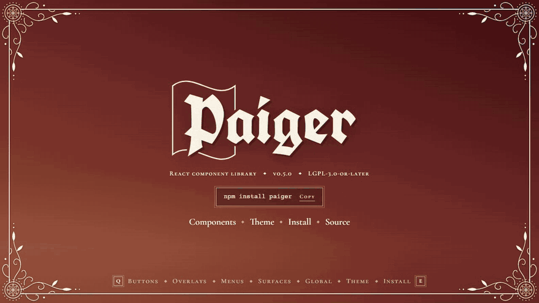

<p align="center">
  
</p>

# paiger

A small React component library with a neutral default look that you restyle through CSS custom properties. Buttons, menus and selects show their own loading state when you return a promise.

[Demo](https://serialexperimentsrio.github.io/paiger/) · [Changelog](CHANGELOG.md)

The demo's ornamental style is one theme built on these components; the defaults are plain, so you can take them in any direction.

## Quick start

paiger isn't on npm yet. Until it is, build a tarball from this repo and install that:

```bash
git clone https://github.com/serialexperimentsrio/paiger.git
cd paiger
bun install && bun run build && npm pack
# then, in your app:
npm install ../paiger/paiger-0.5.0.tgz
```

```tsx
import 'paiger/styles.css'
import { PaigerProvider } from 'paiger'

<PaigerProvider>
  <App />
</PaigerProvider>
```

> [!WARNING]
> This library is still in active development. Components may exhibit bugs or unintended behavior and are not yet recommended for production use.

Needs React 18 or 19. Wrap your app in `PaigerProvider` once, inside your other providers (router, theme, store).

The stylesheet holds the component styles and the default theme; the components don't inject any CSS themselves. The provider is where modals and toasts render. Because it sits inside your app, a modal's content can use your router, theme, store and any other context.

The package is marked `'use client'`, so in Next.js's App Router you can import it straight into a server layout.

## Components

| Component | Description |
|---|---|
| `Box` | Surface with an optional background image and corner icon |
| `Button` | Button with sizes, a ghost variant and a built-in async loading state |
| `Checkbox` | Native checkbox with its label, including the mixed state |
| `Dropdown` | Menu of actions under a trigger |
| `Icon` | Image icon that stays square; `tint` draws it in the text colour |
| `IconButton` | Square button around an `Icon` |
| `Input` / `Textarea` | Native text fields, with styling for `aria-invalid` |
| `Loading` | Three dots in a travelling wave |
| `Panel` | `Box` with a title row |
| `Popover` | Content that opens next to its trigger, on whichever side has room; `open` controls it from outside |
| `Radio` | Native radio button with its label |
| `Select` | Pick one value from a list, controlled or not |
| `Switch` | On and off control, announced as a switch |
| `Tabs` | Panels of content behind a row of tabs |
| `Tooltip` | Hint on hover and keyboard focus |
| `setModal` / `ModalBox` | One modal at a time, with back history |
| `toast` / `ToastBox` | Stacking notifications |

```tsx
<Button onClick={async () => await save()}>Save</Button>
<Button size="small" variant="ghost" danger>Delete</Button>

<Tooltip content="Copy link" placement="right">
  <IconButton aria-label="Copy link"><Icon src="/link.svg" /></IconButton>
</Tooltip>

<Dropdown items={[{ key: 'pdf', label: 'Export as PDF', onSelect: exportPdf }]}>
  <Button>Export</Button>
</Dropdown>

<label htmlFor="email">Email</label>
<Input id="email" type="email" aria-invalid={!valid} aria-describedby="email-error" />
<Checkbox checked={agreed} onChange={(e) => setAgreed(e.target.checked)}>I agree</Checkbox>
<Switch defaultChecked>Notifications</Switch>

<Tabs aria-label="Product" items={[
  { key: 'overview', label: 'Overview', content: <Overview /> },
  { key: 'specs', label: 'Specs', content: <Specs /> },
]} />

<Select
  name="font"
  options={[{ value: 'serif', label: 'Serif' }, { value: 'sans', label: 'Sans' }]}
  value={font}
  onChange={setFont}
/>

setModal(<ModalBox title="Settings">…</ModalBox>, () => console.log('closed'))
toast('Archived.', { type: 'warning', action: { label: 'Undo', onClick: restore } })
```

A few things work the same way everywhere:

- **Busy states.** Return a promise from `Button`'s `onClick`, a `Dropdown` item's `onSelect` or `Select`'s `onChange`, and that control shows a light sweeping along its edges until the promise settles. Pass `loading` to a `Button` to show it from outside. For anything else that's waiting, use `<Loading />`.
- **Placement.** `Tooltip`, `Popover`, `Dropdown` and `Select` take `placement`: `'top'`, `'bottom'`, `'left'` or `'right'`. `Popover`, `Dropdown` and `Select` pick the side with the most room when it's left out; `autoPlacements` limits which sides they try.
- **Form controls.** `Input`, `Textarea`, `Checkbox`, `Radio` and `Switch` are the native elements, restyled, so forms, labels, validation and the keyboard work as usual and every native attribute passes through. Checkbox, Radio and Switch wrap their children in the `<label>`; their `className` and `style` go on that label, everything else and the `ref` on the input. Group radios with one `name` inside a `<fieldset>` and `<legend>`.
- **Triggers.** The child of `Tooltip`, `Popover` and `Dropdown` needs to accept a ref (any DOM element or `forwardRef` component does). Its own ref keeps working.
- **Keyboard.** Popovers, menus and modals close with Escape and hand focus back to what opened them; with one inside another, Escape closes the innermost. Escape also hides a tooltip. Menus and selects take arrow keys, Home, End and type-to-jump. Modals trap Tab.
- **Layers.** Popovers, menus, tooltips and toasts open in the browser's top layer, above everything else on the page, whatever its `z-index`.
- **Modals.** `onClose` runs once per modal, when it's gone for good: closed (by `hideModal()`, Escape, the backdrop or the ×) or left with `openPreviousModal()`. A modal replaced by another waits in the history, and closing clears the history and runs those too. The page behind is `inert` and can't scroll while one is open; toasts stay usable. The content is rendered once when you call `setModal`, so keep state the modal shows inside it or in a store, not in the props you pass.
- **Labels.** The text screen readers hear for the modal's ×, the toast's × and `Loading` is English. Pass `<PaigerProvider labels={{ close, dismiss, loading }}>` to replace it.
- **Motion.** Animation lengths come from the `--pg-duration-*` variables, and everything stops moving when the user asks for reduced motion.

## Theming

All visual properties are driven by CSS custom properties. The defaults shipped in `paiger/styles.css` are:

```css
:root {
  --pg-color-main: #141414;     /* component backgrounds */
  --pg-color-accent: #444444;   /* borders, hover states */
  --pg-color-bright: #f0f0f0;   /* primary text */
  --pg-color-dim: #888888;      /* muted/disabled text */
  --pg-color-danger: rgba(255, 133, 133, 0.16);  /* danger tint */
  --pg-color-warning: rgba(255, 200, 0, 0.16);   /* warning tint */
  --pg-color-success: rgba(0, 200, 100, 0.16);   /* success tint */
  --pg-color-backdrop: rgba(0, 0, 0, 0.3);       /* modal overlay */

  --pg-border-width: 2px;
  --pg-radius: 0px;             /* corner radius of every surface */
  --pg-shadow: 0 0 #0000;       /* drop shadow of every surface */
  --pg-font: inherit;           /* font of every component */

  --pg-font-size: 1rem;         /* text in buttons, selects and menus */
  --pg-padding: 20px;           /* inside Box, Panel and modals */
  --pg-control-padding-y: 10px; /* buttons, select, menu items */
  --pg-control-padding-x: 20px;
  --pg-check-size: 18px;        /* checkbox and radio; a switch is twice as wide */
  --pg-tooltip-padding: 4px 8px;
  --pg-tooltip-max-width: 280px; /* longer tooltips wrap */
  --pg-toast-width: 300px;
  --pg-modal-margin: 35px;      /* least space around a modal */

  --pg-loading-size: 6px;       /* each loading dot */
  --pg-loading-gap: 4px;
  --pg-loading-speed: 1.2s;     /* one full wave */

  --pg-z-modal: 2000;           /* popovers, tooltips and toasts sit above it, in the top layer */

  --pg-transition-fast: 0.12s ease;
  --pg-transition-base: 0.24s ease;

  --pg-duration-modal: 0.4s;
  --pg-duration-popover: 0.3s;
  --pg-duration-tooltip: 0.2s;  /* hiding takes twice as long */
}
```

To override any variable, redefine it on `:root` (or any element) in your own CSS. The defaults have zero specificity, so your values win regardless of load order:

```css
:root {
  --pg-color-main: #1a1a2e;
  --pg-color-accent: #2a2a4a;
  --pg-color-bright: #ffffff;
}

/* Or only in one part of your app */
.sidebar {
  --pg-color-main: #0d0d0d;
}
```

`--pg-shadow` must stay a valid shadow (use `0 0 #0000` rather than `none`), because the modal combines it with its border.

### Light and dark

The default colours are dark. For the built-in light palette, or to follow the system setting, put `data-pg-theme` on `<html>` or on any element:

```html
<html data-pg-theme="auto">   <!-- light or dark, following the system -->
<div data-pg-theme="light">   <!-- always light in here -->
```

`"dark"` is there too, for a dark area inside a light one. These palettes use the CSS `light-dark()` function (Chrome 123+, Safari 17.5+, Firefox 120+).

## Styling components

Tokens cover colours, shape and sizing. For anything else, write ordinary CSS against the stable class names below.

All of paiger's CSS lives in a cascade layer called `paiger`, so your own unlayered CSS always wins. You don't need `!important` or extra specificity, and load order doesn't matter:

```css
.pg-button {
  border-radius: 999px;
  background: linear-gradient(#ffffff, #dde8f0);
}

.pg-button:hover {
  background: linear-gradient(#eaf6fd, #a7d9f5);
}

.pg-button[data-loading] {
  opacity: 0.6;
}
```

If your own CSS is in layers too (Tailwind v4 is), say where paiger goes. Put it after any reset, or the reset wipes its padding and borders, and before the layers that should be able to restyle it:

```css
@layer theme, base, paiger, components, utilities;
```

Layer order is fixed by whichever stylesheet names a layer first, so this line has to load before `paiger/styles.css`. With Tailwind, put it at the top of your main CSS file and import that file before paiger's.

| Class | Element | State attributes |
|---|---|---|
| `pg-box` | `Box`, and the surface of `Panel`, `ModalBox` and toasts | |
| `pg-box-image`, `pg-box-icon` | `Box` background image and corner icon | |
| `pg-button` | `Button` and `IconButton` | `data-loading`, `data-danger`, `data-size`, `data-variant`, `disabled` |
| `pg-icon-button` | `IconButton` | |
| `pg-icon` | `Icon` | |
| `pg-input`, `pg-textarea` | `Input` and `Textarea` | `aria-invalid`, `disabled` |
| `pg-checkbox`, `pg-checkbox-input`, `pg-checkbox-label` | `Checkbox`'s label, box and text | `:checked`, `:indeterminate`, `disabled` on the box |
| `pg-radio`, `pg-radio-input`, `pg-radio-label` | `Radio`'s label, circle and text | `:checked`, `disabled` on the circle |
| `pg-switch`, `pg-switch-input`, `pg-switch-label` | `Switch`'s label, track and text | `:checked`, `disabled` on the track |
| `pg-tabs`, `pg-tabs-list`, `pg-tab`, `pg-tabs-panel` | `Tabs` wrapper, list, each tab and the panel | `aria-selected`, `disabled` on a tab |
| `pg-loading`, `pg-loading-dot` | `Loading` and each of its dots | |
| `pg-panel`, `pg-panel-title`, `pg-panel-box` | `Panel` wrapper, title row and body | |
| `pg-popover`, `pg-popover-content` | `Popover` layer and its content wrapper | |
| `pg-dropdown`, `pg-dropdown-item` | The menu or list, and each item | `data-loading` on the item |
| `pg-select`, `pg-select-arrow` | `Select` trigger and its arrow | `aria-expanded` |
| `pg-tooltip`, `pg-tooltip-text` | `Tooltip` box and text | |
| `pg-modal`, `pg-modal-content`, `pg-modal-title`, `pg-modal-close` | `ModalBox` frame, content, title and × | |
| `pg-modal-backdrop` | The backdrop behind modals | `data-active` |
| `pg-toast`, `pg-toast-action`, `pg-toast-dismiss` | Each toast, its action and its × | `data-type` |
| `pg-toast-container` | The stack of toasts | |

Every component except `Popover`, `Dropdown` and `Tooltip` takes a `className`, added alongside these. `Box`, `Button`, `Checkbox`, `Icon`, `IconButton`, `Input`, `Loading`, `Panel`, `Radio`, `Select`, `Switch`, `Tabs` and `Textarea` forward their `ref` (`Select`'s is its trigger button, which also takes `id` and `disabled`).

## Versioning

Until 1.0, a minor version (0.5 → 0.6) may break things and a patch version (0.5.0 → 0.5.1) won't. Every release and how to upgrade to it is in [CHANGELOG.md](CHANGELOG.md).

## Development

```bash
bun install
bun run demo:dev   # the demo, with the library source hot-reloading
bun run test       # Playwright tests against the demo's test page
bun run build
```

## Browser Requirements

paiger uses the [Web Animations API](https://developer.mozilla.org/en-US/docs/Web/API/Web_Animations_API) and the [HTML Popover API](https://developer.mozilla.org/en-US/docs/Web/API/Popover_API). No polyfills are included.

Minimum supported browsers: Chrome 114+, Safari 17+, Firefox 125+.

## License

Copyright 2026 Rio <engineer@disr.it>

Licensed under the GNU Lesser General Public License v3.0 or later. See [LICENSE](LICENSE) for details.
